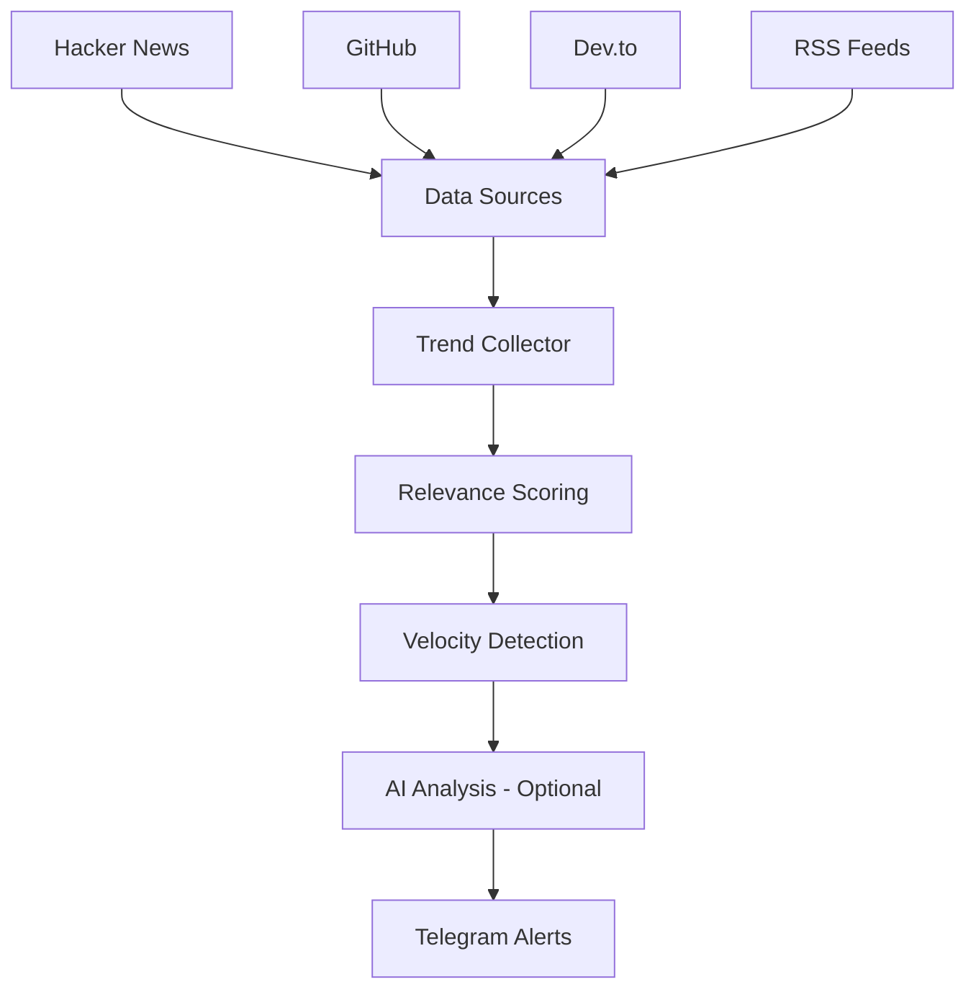
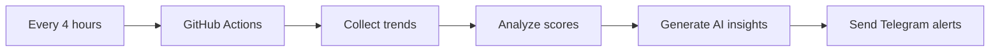

# 🚀 Trend Radar — AI-Powered Developer Intelligence Agent

Trend Radar is an AI-powered technology trend monitoring system that discovers what's gaining attention across **Hacker News, GitHub, Dev.to, and RSS feeds**, analyzes relevance against your personal technology stack, detects breakout trends, and delivers high-signal developer insights directly to Telegram.

Instead of endlessly scrolling through tech news, Trend Radar helps developers, founders, and engineers discover **important emerging technologies, tools, frameworks, and industry movements before they become mainstream**.

> Find what is trending. Understand why it matters. Save ideas worth building.

---

## ✨ Features

### 🔎 Multi-Source Trend Collection

Automatically collects trending developer content from:

- 📰 Hacker News
- 🐙 GitHub Trending / GitHub Search API
- ✍️ Dev.to
- 📡 Custom RSS feeds

No paid APIs required.

---

### 🎯 Personalized Technology Matching

Trend Radar scores content based on your own interests and technology stack.

```python
STACK_KEYWORDS = [
    "golang",
    "docker",
    "kubernetes",
    "llm",
    "ai agents",
    "react",
    "postgres"
]
```

A trending Kubernetes article or AI agent framework receives a higher relevance score than unrelated news.

---

### 🚀 Breakout Trend Detection

Detects when previously discovered content suddenly gains momentum.

```
🚀 BREAKOUT

Project:
New open-source AI agent framework

Why:
Score increased by 70%
GitHub stars accelerating
High developer engagement
```

Velocity detection helps identify technologies that are rapidly gaining adoption.

---

### 🤖 AI-Powered Trend Explanations

Optional Gemini-powered analysis generates a short explanation of *"why does this matter to you?"*

```
LangGraph update

AI Angle:
"This could simplify building production-ready AI agent
workflows using your existing Python stack."
```

Uses efficient Gemini Flash-Lite models to minimize cost.

---

### 📲 Telegram Intelligence Feed

Receive personalized trend alerts directly in Telegram.

- Ranked trend notifications
- One-click save button
- Duplicate prevention
- Persistent history
- Automated scheduled updates

```
🔥 AI Agent Framework Trending

Score: 92/100

Why:
Matches your AI + Go interests

💾 Save
```

---

## 🏗️ Architecture



---

## Why Trend Radar?

The internet produces thousands of developer updates every day. Most tools answer *"what happened?"*

Trend Radar answers *"what is gaining momentum, and why should I care?"*

It helps you:

- Discover new technologies
- Find open-source projects early
- Track developer ecosystem changes
- Generate content ideas
- Identify startup opportunities
- Stay ahead of engineering trends

---

## 🚀 Installation

### 1. Create a Telegram Bot

1. Open Telegram
2. Message `@BotFather`
3. Run:
   ```
   /newbot
   ```
4. Copy your bot token
5. Send any message to your new bot
6. Open:
   ```
   https://api.telegram.org/bot<YOUR_TOKEN>/getUpdates
   ```
7. Copy your chat ID

### 2. Set Up Gemini AI (Optional)

Create a Gemini API key from Google AI Studio.

If you don't want AI explanations:

```python
ENABLE_AI_ANGLES = False
```

Trend Radar works without AI.

### 3. Local Setup

Clone the repository:

```bash
git clone https://github.com/Xbot-me/ImprovedSniffle.git
cd ImprovedSniffle
```

Install dependencies:

```bash
pip install -r requirements.txt
```

Configure environment variables:

```bash
export TELEGRAM_BOT_TOKEN="your-token"
export TELEGRAM_CHAT_ID="your-chat-id"
export GEMINI_API_KEY="your-key"
```

Run the collector:

```bash
python collector.py
```

Send notifications:

```bash
python notify_telegram.py
```

---

## ☁️ Automated Deployment with GitHub Actions

Trend Radar can run completely serverless using GitHub Actions.



Required GitHub Secrets:

```
TELEGRAM_BOT_TOKEN
TELEGRAM_CHAT_ID
GEMINI_API_KEY
```

SQLite data persistence is handled through GitHub Actions caching.

---

## ⚙️ Configuration

Customize your intelligence feed:

**Technology Stack Keywords** — edit `config.py`:

```python
STACK_KEYWORDS = [
    "AI",
    "LLM",
    "Go",
    "Docker",
    "React",
    "Cloud",
    "Open Source"
]
```

**RSS Sources** — add your favorite feeds:

```python
RSS_FEEDS = [
    "https://example.com/feed"
]
```

**Trend Velocity Settings** — control breakout detection:

```
VELOCITY_GROWTH_THRESHOLD
VELOCITY_MIN_ABSOLUTE_DELTA
```

---

## 📁 Project Structure

```
trend-radar/
├── collector.py          # Fetches, scores and stores trends
├── notify_telegram.py    # Sends ranked notifications
├── config.py             # Keywords and source configuration
├── schema.sql             # SQLite database schema
└── sources/
    ├── hackernews.py      # Hacker News API integration
    ├── github_trending.py # GitHub trend collection
    ├── devto.py           # Dev.to integration
    └── rss_feeds.py       # RSS/Atom feed collector
```

---

## 🛣️ Roadmap

Future versions may include:

- AI-generated technical summaries
- Automatic blog post generation
- LinkedIn/X content creation
- Startup idea detection
- Personalized newsletters
- Web dashboard
- More data sources
- Multi-user support

---

## 🤝 Contributing

Contributions are welcome. Ideas, improvements, new data sources, and AI workflows are encouraged.

## 📄 License

MIT License
